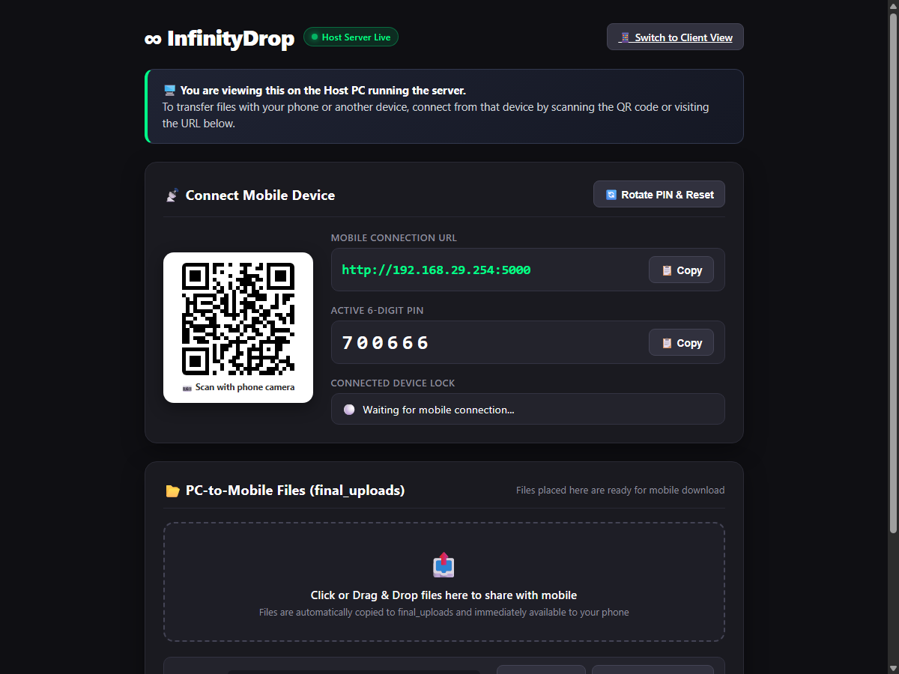
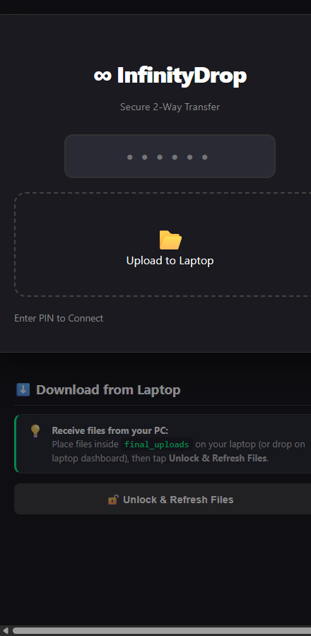

<h1 align="center">∞ InfinityDrop</h1>

<p align="center">
  <strong>Secure, high-speed, peer-to-peer local file transfer using Python and Flask.</strong>
</p>

<p align="center">
  
  &nbsp;&nbsp;
  
</p>

InfinityDrop is a web-based application that allows seamless two-way file sharing between devices on the same Wi-Fi network. It completely bypasses the internet, ensuring maximum transfer speeds, zero data consumption, and complete privacy.

## ✨ Features

* **Blazing Fast Local Transfers:** Uses your local router's bandwidth, making it 10x-20x faster than Bluetooth.
* **Chunked Upload Protocol:** Large files are split into 1MB chunks. If a network hiccup occurs, it resumes exactly where it left off without starting over.
* **Batch Transfer Mode:** Select multiple files and upload them seamlessly in a single queue.
* **Dynamic PIN Authentication:** Generates a secure 6-digit session PIN. The PIN automatically rotates the moment a batch transfer completes, preventing unauthorized access.
* **Device Lock:** Once a device connects using the PIN, the session locks to that specific IP address, preventing "Man in the Middle" interceptions.
* **Cross-Platform:** No app installation required on the client device—just a modern web browser.

## 🚀 How to Run Locally

### Prerequisites
Make sure you have [Python](https://www.python.org/downloads/) installed on your system.

### 1. Clone the repository
```bash
git clone https://github.com/Parth-Chavan-15/InfinityDrop
cd InfinityDrop
```

### 2. Install Dependencies
Install the required Python packages using pip:
```bash
pip install -r requirements.txt
```

### 3. Start the Server
Run the Flask application:
```bash
python app.py
```

### 4. Connect
The terminal will output:
* **Host Dashboard (PC):** Open `http://localhost:5000` on your host laptop to view the live QR code, active PIN, device connection status, and share files.
* **Mobile Connection:** Open the local IP address (e.g., `http://192.168.1.5:5000`) or scan the QR code from your laptop screen on any device connected to the same Wi-Fi network.

Enter the 6-digit PIN on mobile to unlock the interface and start transferring files!

### 5. Send Files from PC to Mobile Device
To transfer files from your laptop to your connected mobile device:
* **Option A (Host Dashboard):** Drag & drop files directly onto the Host Dashboard in your laptop's browser.
* **Option B (File Explorer):** Copy and paste files directly into the `final_uploads` folder on your laptop.

Tap **"🔓 Unlock & Refresh Files"** on your mobile device, and the files will immediately appear ready to download!

## 🛠️ Tech Stack
Backend: Python, Flask, Werkzeug

Frontend: HTML5, Vanilla JavaScript, CSS3

Libraries: Resumable.js (for chunked file handling), QRCode.js, Flask-CORS

## 📁 Project Structure
<pre>
InfinityDrop/
├── app.py                # Main Flask server and API endpoints
├── requirements.txt      # Python dependencies
├── .gitignore            # Ignored files and folders
├── assets/               # UI preview screenshots
├── static/               # Offline frontend libraries (QRCode.js, Resumable.js)
└── templates/
    ├── host.html         # Host PC dashboard and file manager
    └── index.html        # Mobile/client UI and transfer logic
</pre>
